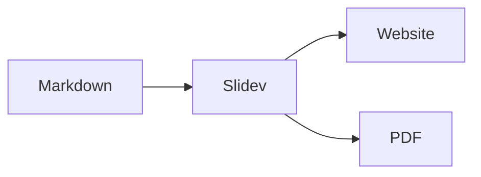
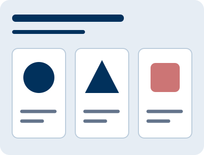

# Slidev

Markdown-Folien erstellen, präsentieren und exportieren

Kurzer Überblick über Bedienung, Layouts und Funktionen

---

# Bedienung

| Taste | Funktion |
| --- | --- |
| <kbd>←</kbd> / <kbd>→</kbd> | vorherige / nächste Folie |
| <kbd>O</kbd> | Übersicht öffnen |
| <kbd>P</kbd> | Presenter Mode öffnen |
| <kbd>F</kbd> | Fullscreen ein- oder ausschalten |

Unten links erscheint beim Bewegen der Maus zusätzlich die Navigation.

---
layout: section
---

# Zentrale Layouts

Wenige Layouts decken die meisten Folien ab.

---

# Default Layout

Das `default` Layout wird ohne besondere Angabe verwendet.

- Überschriften und Listen
- **fetter**, *kursiver* und `inline code` Text
- [Links](https://sli.dev/) und Bilder
- Blockquotes für Hinweise

> Inhalte möglichst mit normalem Markdown schreiben.

---
layout: two-cols
---

# Two Columns

Die linke Spalte beginnt direkt nach dem Frontmatter.

- Erklärungen
- Begriffe
- kurze Listen

::right::

## Rechte Spalte

`::right::` trennt beide Spalten.

```md
---
layout: two-cols
---

Left column

::right::

Right column
```

---
layout: exercise
---

# Exercise Layout

Dieses Layout kennzeichnet Aufgaben automatisch mit **Aufgabe** und mit dem
roten Farbakzent.

1. Formuliere ein überprüfbares Ergebnis.
2. Ergänze bei Bedarf eine Hilfestellung.
3. Biete eine Zusatzaufgabe an.

> Hilfe: Das Layout wird mit `layout: exercise` gewählt.

---

# Code hervorheben

Zeilen können schrittweise markiert werden.

```js {1-4|6|7|all}
const projects = [
  { id: 1, title: 'Gallery', featured: true },
  { id: 2, title: 'Blog', featured: false },
];

const featured = projects.filter(project => project.featured);
const titles = featured.map(project => project.title);
```

Die Angaben `{1-4|6|7|all}` steuern die Schritte.

---

# Inhalte schrittweise zeigen

`v-clicks` blendet Listeneinträge einzeln ein.

<v-clicks>

1. Inhalt erklären
2. Beispiel zeigen
3. Verständnis prüfen

</v-clicks>

<v-click>

> `v-click` eignet sich auch für einen einzelnen Block.

</v-click>

---

# Mermaid Diagramme

Diagramme entstehen direkt aus einem Codeblock.



Farben und Schrift werden zentral durch das Repository-Theme festgelegt.

---

# Tabellen, Bilder und Links

| Element | Markdown |
| --- | --- |
| Link | `[Slidev](https://sli.dev/)` |
| Bild | `` |
| Tabelle | Zeilen mit `\|` trennen |



Lokale Bilder mit Alt-Text bleiben auch auf GitHub verständlich.

---

# Presenter Mode und Notizen

Speaker Notes stehen als HTML-Kommentar unter dem Folieninhalt.

```md
<!--
Only the presenter can see this note.
-->
```

Mit <kbd>P</kbd> öffnet sich der Presenter Mode mit aktueller Folie, Vorschau,
Notizen und Zeitmessung.

<!--
Diese Notiz demonstriert den Presenter Mode und erscheint nicht auf der Folie.
-->

---

# Übersicht, Export und Theme

- <kbd>O</kbd> zeigt alle Folien als Übersicht.
- Der PDF-Export übernimmt das Aussehen der Folien.
- Logo, Farben, Fonts, Seitenzahlen und Abstände gelten zentral für alle Decks.
- Gemeinsame Einstellungen kommen aus `slidev-theme-litec` und müssen beim Schreiben nicht
  verändert werden.

> Neue Foliensätze brauchen hauptsächlich Markdown und wenige Layout-Angaben.

---
layout: section
---

# Bereit für eigene Folien

Markdown schreiben · Layout wählen · im Browser prüfen

Pfeiltasten: Navigation · O: Übersicht · P: Presenter Mode
